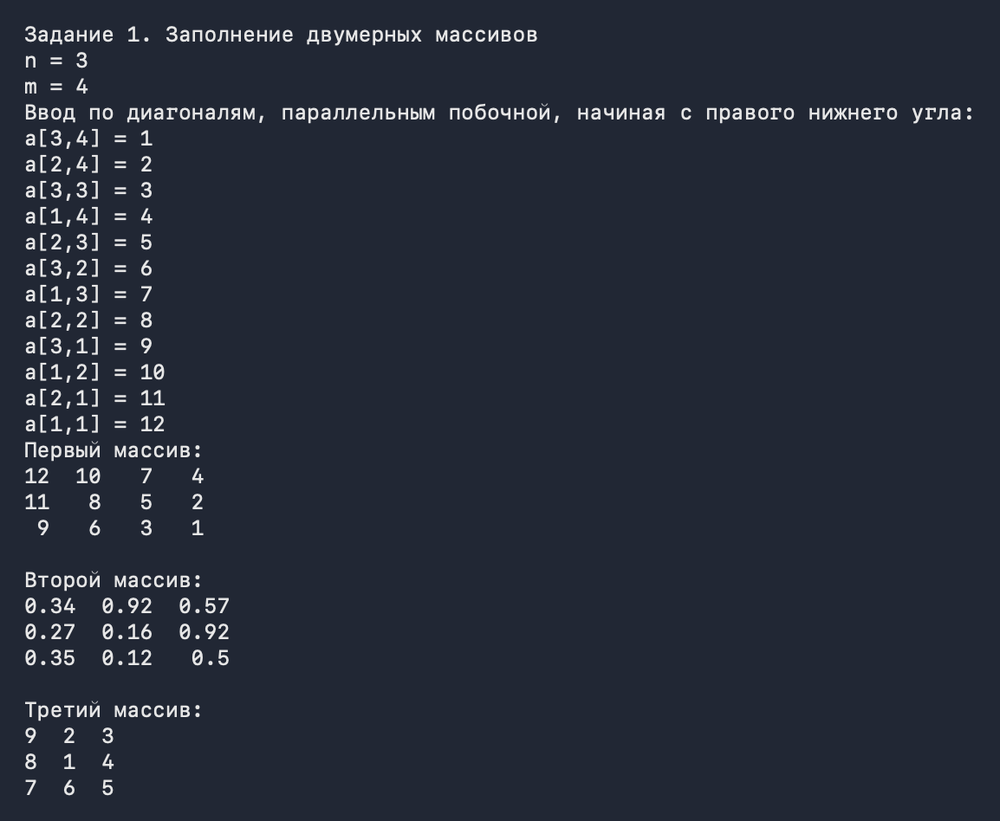
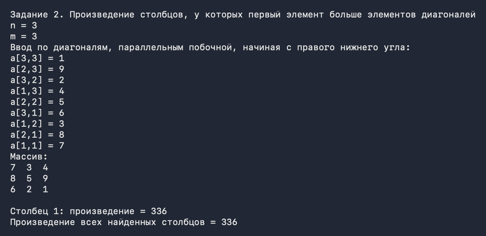
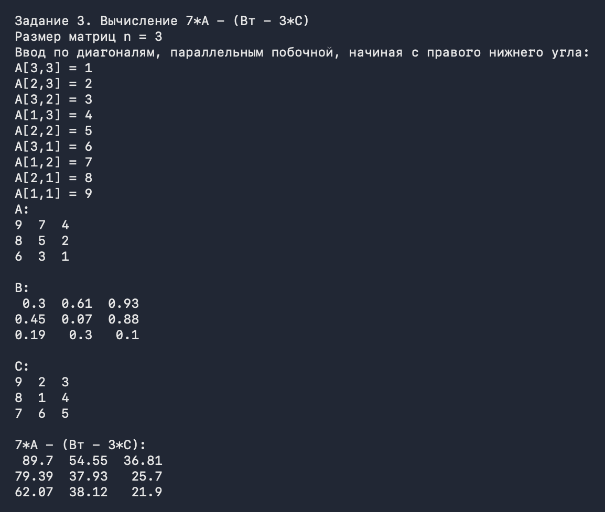
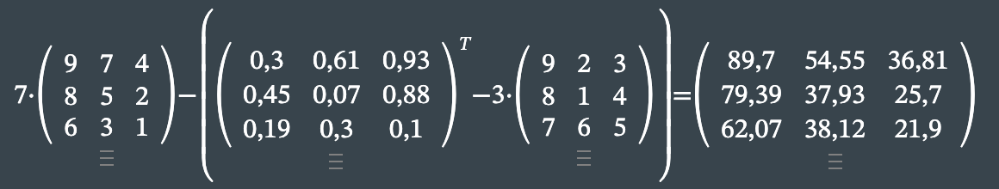
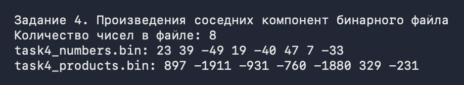
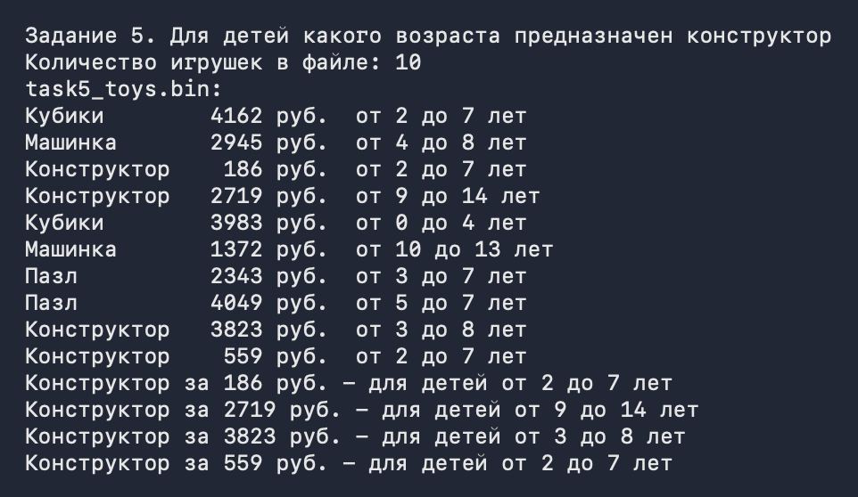
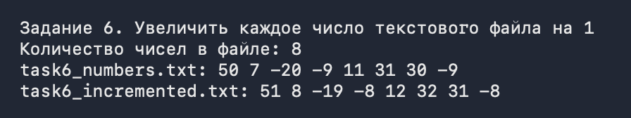
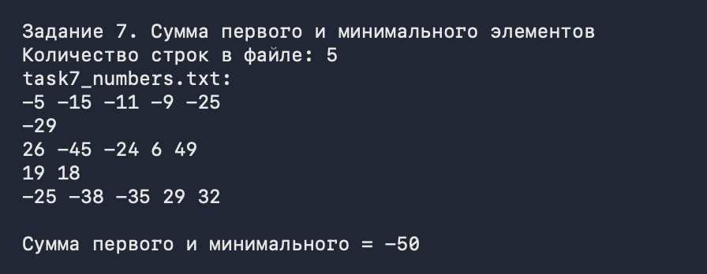
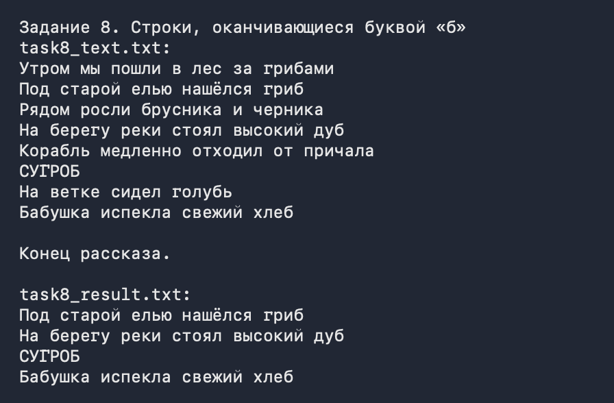

# Лабораторная работа №3. Массивы и файлы

Выполнил: Владимиров Савелий Олегович  
Вариант: 15

## Постановка задачи

Все задания выполняются в одном проекте. Задания 1-3 сделаны методами класса `Matrix`, у которого единственное поле - двумерный массив, задание 1 реализовано конструкторами. Задания 4-8 сделаны статическими методами отдельного класса `FileTasks`.

1. Первый массив n x m заполняется с клавиатуры по диагоналям, параллельным побочной, начиная с правого нижнего угла. Второй массив n x n заполняется случайными числами из [0; 1] так, что выше главной диагонали лежат числа больше 0.5, а на главной диагонали и ниже - меньше или равные 0.5. Третий массив n x n заполняется так же, как для n = 5:
   ```
   25 10 11 12 13
   24  9  2  3 14
   23  8  1  4 15
   22  7  6  5 16
   21 20 19 18 17
   ```
2. Вычислить произведение тех столбцов двумерного массива (номера этих столбцов вывести), у которых первый элемент больше элементов, расположенных на главной и побочной диагонали.
3. Перегрузив операторы, вычислить выражение `7*A - (Bт - 3*C)`. Перегрузить `ToString()`, чтобы матрица выводилась таблицей.
4. Бинарный файл с числами, исходный файл заполняется случайными числами. Заполнить новый файл числами, которые являются произведениями соседних компонент исходного файла.
5. Бинарный файл со структурами, обязательно XML-сериализация. Файл содержит сведения об игрушках: название, стоимость в рублях и возрастные границы. Для детей какого возраста предназначается конструктор?
6. Текстовый файл с целыми числами по одному в строке. Получить новый файл, увеличив каждый элемент исходного на 1.
7. Текстовый файл с целыми числами по несколько в строке. Найти сумму первого и минимального элементов.
8. Текстовый файл с произвольным текстом. Переписать в другой файл строки, заканчивающиеся буквой "б".

## Этапы решения

Программа запускается с меню, где выбирается номер задания.

### Задание 1

`Matrix(int rowCount, int columnCount, Func<int, int, double> readElement)` - заполнение с клавиатуры. У всех элементов одной диагонали, параллельной побочной, одинаковая сумма индексов `row + column`. Я перебираю эту сумму от `n + m - 2` (правый нижний угол) до 0, а внутри диагонали иду сверху вниз. Функция `readElement` получает номер строки и столбца, поэтому программа пишет подсказку вида `a[2,4] = ` и сразу видно порядок заполнения.

`Matrix(int size, Random random)` - случайный массив. Если `column > row`, элемент выше главной диагонали и берется из чисел 0.51 ... 1.00, иначе из 0.00 ... 0.50. Числа получаются с точностью до сотых, чтобы матрицу B из задания 3 можно было без округлений ввести в онлайн-калькулятор.

`Matrix(int size)` - третий массив. Если идти от n² к 1, получается спираль: от левого верхнего угла вниз по первому столбцу, вправо по нижней строке, вверх по правому столбцу, влево по верхней строке, потом границы сужаются и все повторяется. Так работает для любого n, в том числе четного.

### Задание 2

Условие я понял так: первый элемент столбца должен быть строго больше каждого элемента главной и побочной диагонали. Если первый элемент сам лежит на диагонали (первый и последний столбец), то с самим собой он не сравнивается. Для прямоугольного массива диагонали берутся длиной min(n, m).

`FindColumnsWithFirstElementAboveDiagonals()` возвращает номера подходящих столбцов, `GetColumnProduct(column)` считает произведение элементов столбца. Программа выводит номер каждого столбца (нумерация с 1), его произведение и произведение всех найденных столбцов вместе.

### Задание 3

Перегружены операторы `*` (число на матрицу) и `-` (матрица минус матрица), транспонирование сделано методом `Transpose()`. Результат операции создается закрытым конструктором `Matrix(double[,] elements)`. В итоге выражение в коде записано так же, как в задании:

```csharp
var result = 7 * matrixA - (matrixB.Transpose() - 3 * matrixC);
```

Матрица A вводится с клавиатуры, B заполняется случайно, C - спираль из задания 1, все размером n x n. `ToString()` выравнивает столбцы по ширине самого длинного числа.

### Задание 4

`FillBinaryFileWithRandomNumbers` пишет в файл случайные `int` из [-50; 50] через `BinaryWriter`. `WriteAdjacentProducts` читает исходный файл по одному числу, помнит предыдущее и записывает в новый файл произведение предыдущего и текущего. Произведение пишется как `long`, потому что два `int` при умножении могут переполниться. Из n чисел получается n - 1 произведение.

### Задание 5

`Toy` - структура (`readonly record struct`) с полями Name, Price, MinAge, MaxAge. Каждая игрушка сериализуется `XmlSerializer` в строку, и эта строка записывается в бинарный файл через `BinaryWriter`. При чтении наоборот: `ReadString()`, потом `Deserialize`. Получается бинарный файл последовательного доступа, в котором каждая запись - сериализованная структура.

`FillToysFile` заполняет файл случайными игрушками: название из списка, цена 100-5000 руб., нижняя граница возраста 0-10 лет, верхняя больше нее на 1-6 лет. `FindBuildingSets` возвращает все игрушки с названием "Конструктор" (без учета регистра), и программа выводит для каждой возрастные границы.

### Задание 6

`FillTextFileWithRandomNumbers` пишет случайные числа по одному в строке. `WriteIncrementedNumbers` читает файл построчно через `File.ReadLines`, прибавляет к каждому числу 1 и пишет результат в новый файл. Пустые строки пропускаются.

### Задание 7

`FillTextFileWithRandomNumberRows` пишет строки, в каждой от 1 до 5 случайных чисел через пробел. `CalculateSumOfFirstAndMinimum` за один проход по файлу запоминает первое число и ищет минимум. Если в файле нет ни одного числа, выбрасывается `InvalidOperationException`.

### Задание 8

`CopyLinesEndingWith(sourcePath, resultPath, 'б')` переписывает строки, у которых последний символ - "б" или "Б". Пробелы в конце строки не учитываются. Если файла с текстом еще нет, программа создает его с примером текста, потом его можно поменять и запустить задание еще раз.

## Тестирование

### Задание 1

n = 3, m = 4, вводил числа от 1 до 12 по порядку подсказок. Ожидаемый первый массив:

```
12 10  7  4
11  8  5  2
 9  6  3  1
```

Во втором массиве выше главной диагонали стоят 0.92, 0.57, 0.92 (больше 0.5), на диагонали и ниже - числа от 0.12 до 0.5. Третий массив - спираль 3 x 3.



### Задание 2

n = m = 3, вводил 1, 9, 2, 4, 5, 6, 3, 8, 7, получился массив

```
7 3 4
8 5 9
6 2 1
```

Элементы диагоналей: 7, 5, 1 и 4, 5, 6. Больше всех них только первый элемент первого столбца (7), поэтому ответ - столбец 1, произведение 7 * 8 * 6 = 336.



### Задание 3

n = 3, A вводил числами от 1 до 9, B получилась случайной, C - спираль. Те же матрицы ввел в онлайн-калькулятор matrixcalc.org, ответ совпал.





### Задание 4

8 случайных чисел, в новом файле 7 произведений: 23 * 39 = 897, 39 * (-49) = -1911, -49 * 19 = -931 и т.д.



### Задание 5

10 случайных игрушек, среди них 4 конструктора. Для каждого программа вывела возрастные границы из файла.



### Задание 6

8 случайных чисел, в новом файле каждое больше на 1: 50 -> 51, -20 -> -19 и т.д.



### Задание 7

5 строк со случайными числами. Первое число -5, минимальное -45, сумма -50.



### Задание 8

В новый файл попали строки, которые заканчиваются на "б", в том числе "СУГРОБ" и строка с пробелами в конце. Строка про голубя (кончается на "ь") и строка "...за грибами" (буква "б" есть, но не в конце) не попали.


